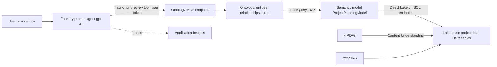

This page explains the demo as it is configured today (state of 6 November 2026). It follows the files in the repository from the outside in: Azure resources, deployment, document extraction, data, semantic model, ontology, and the agent. For each part it names the file, the settings in it, the Microsoft documentation that describes the setting, the place in the Azure or Fabric portal where you can see the result, and what is good and bad about the choice.

Related pages: [how-it-works.md](how-it-works.md) explains the concepts for readers new to Fabric. [microsoft-guidance.md](microsoft-guidance.md) holds the evidence for every place where the demo goes beyond the documentation. This page is the map between all of it.

## How to read this page

* "Docs" links point to Microsoft Learn pages. Where Microsoft documents only a portal path and the demo does it by code, the text says so.
* "Portal" links open the live demo environment. They contain the tenant, subscription and item IDs of this deployment. A deployment in another environment has other IDs, so take the pattern, not the IDs. The Fabric item IDs change when an item is deleted and created again, and `setup.py` does that for the ontology and semantic model only if you delete them by hand.
* "Measured" means that we tested it in this tenant. The numbers come from the work documented in [microsoft-guidance.md](microsoft-guidance.md).
* Strengths and weaknesses are my assessment of this demo, not a general rating of the product.

## Quick links to the live environment

The Azure portal links open the resource by its resource ID. The Fabric links use the item IDs of the current deployment. I checked the Fabric workspace, semantic model, model view and rule URLs in the browser. I built the Azure links from the resource IDs that `az resource list` returned and did not open each one, so a blade name can differ in a future portal version. The overview links are the stable ones.

### Azure portal

Tenant `f71980b2-590a-4de9-90d5-6fbc867da951`, subscription `98525264-1eb4-493f-983d-16a330caa7f6`, resource group `rg-projplan-demo`, region `swedencentral`.

| What | Link |
|------|------|
| Resource group | [rg-projplan-demo](https://portal.azure.com/#@f71980b2-590a-4de9-90d5-6fbc867da951/resource/subscriptions/98525264-1eb4-493f-983d-16a330caa7f6/resourceGroups/rg-projplan-demo/overview) |
| Bicep deployment history (`main`) | [Deployments](https://portal.azure.com/#@f71980b2-590a-4de9-90d5-6fbc867da951/resource/subscriptions/98525264-1eb4-493f-983d-16a330caa7f6/resourceGroups/rg-projplan-demo/deployments) |
| Foundry account (kind `AIServices`) | [ai-projplan-axowf3](https://portal.azure.com/#@f71980b2-590a-4de9-90d5-6fbc867da951/resource/subscriptions/98525264-1eb4-493f-983d-16a330caa7f6/resourceGroups/rg-projplan-demo/providers/Microsoft.CognitiveServices/accounts/ai-projplan-axowf3/overview) |
| Role assignments on the account | [Access control (IAM)](https://portal.azure.com/#@f71980b2-590a-4de9-90d5-6fbc867da951/resource/subscriptions/98525264-1eb4-493f-983d-16a330caa7f6/resourceGroups/rg-projplan-demo/providers/Microsoft.CognitiveServices/accounts/ai-projplan-axowf3/iamAccessAdminBlade) |
| Foundry project | [project-planning](https://portal.azure.com/#@f71980b2-590a-4de9-90d5-6fbc867da951/resource/subscriptions/98525264-1eb4-493f-983d-16a330caa7f6/resourceGroups/rg-projplan-demo/providers/Microsoft.CognitiveServices/accounts/ai-projplan-axowf3/projects/project-planning/overview) |
| Application Insights | [appi-projplan-axowf3](https://portal.azure.com/#@f71980b2-590a-4de9-90d5-6fbc867da951/resource/subscriptions/98525264-1eb4-493f-983d-16a330caa7f6/resourceGroups/rg-projplan-demo/providers/Microsoft.Insights/components/appi-projplan-axowf3/overview) and its [Logs](https://portal.azure.com/#@f71980b2-590a-4de9-90d5-6fbc867da951/resource/subscriptions/98525264-1eb4-493f-983d-16a330caa7f6/resourceGroups/rg-projplan-demo/providers/Microsoft.Insights/components/appi-projplan-axowf3/logs) |
| Log Analytics workspace | [log-projplan-axowf3](https://portal.azure.com/#@f71980b2-590a-4de9-90d5-6fbc867da951/resource/subscriptions/98525264-1eb4-493f-983d-16a330caa7f6/resourceGroups/rg-projplan-demo/providers/Microsoft.OperationalInsights/workspaces/log-projplan-axowf3/overview) |
| Fabric capacity (pause, resume, scale) | [fcprojplanaxowf3](https://portal.azure.com/#@f71980b2-590a-4de9-90d5-6fbc867da951/resource/subscriptions/98525264-1eb4-493f-983d-16a330caa7f6/resourceGroups/rg-projplan-demo/providers/Microsoft.Fabric/capacities/fcprojplanaxowf3/overview) |

The model deployments (`gpt-4.1`, `text-embedding-3-small`), the agent and its tool connection are shown in the Foundry portal at [ai.azure.com](https://ai.azure.com/). Select the project `project-planning` of the account `ai-projplan-axowf3`. Models and agents are under Build. I found no Foundry portal deep link that I could verify, so this one is a path, not an exact link.

### Fabric portal

Workspace `ProjectPlanning` (`66d9c2b2-d35e-4555-9e74-926164ce584c`).

| What | Item ID | Link |
|------|---------|------|
| Workspace | `66d9c2b2-d35e-4555-9e74-926164ce584c` | [ProjectPlanning](https://app.fabric.microsoft.com/groups/66d9c2b2-d35e-4555-9e74-926164ce584c?experience=fabric-developer) |
| Lakehouse `projectdata` (tables, SQL analytics endpoint) | `22d465ee-676f-4ef8-8655-1a7e506d1916` | [projectdata](https://app.fabric.microsoft.com/groups/66d9c2b2-d35e-4555-9e74-926164ce584c/lakehouses/22d465ee-676f-4ef8-8655-1a7e506d1916?experience=fabric-developer) |
| Semantic model `ProjectPlanningModel`, details | `22fb9927-ac28-4092-80c0-0f3d7a56a156` | [Details](https://app.fabric.microsoft.com/groups/66d9c2b2-d35e-4555-9e74-926164ce584c/datasets/22fb9927-ac28-4092-80c0-0f3d7a56a156/details?experience=fabric-developer) |
| Semantic model, model view (tables, relationships, measures, TMDL view) | same | [Model view](https://app.fabric.microsoft.com/groups/66d9c2b2-d35e-4555-9e74-926164ce584c/modeling/22fb9927-ac28-4092-80c0-0f3d7a56a156/modelView?experience=fabric-developer) |
| Ontology `ProjectPlanning` (entity types, relationships, rules) | `8750de7f-d46f-4dd4-84f4-a7e31f68ff24` | [ProjectPlanning](https://app.fabric.microsoft.com/groups/66d9c2b2-d35e-4555-9e74-926164ce584c/ontologies/8750de7f-d46f-4dd4-84f4-a7e31f68ff24?experience=fabric-developer) |
| Rule `EmailCriticality` | lineage tag `715b2ef6-b7f8-5506-a153-11dcf03bf6a2` | [Rule](https://app.fabric.microsoft.com/groups/66d9c2b2-d35e-4555-9e74-926164ce584c/ontologies/8750de7f-d46f-4dd4-84f4-a7e31f68ff24/rules/715b2ef6-b7f8-5506-a153-11dcf03bf6a2?experience=fabric-developer) |
| Rule `EscalationPolicy` | lineage tag `d58c9bff-6a26-5b35-ae9e-ec92b75101e4` | [Rule](https://app.fabric.microsoft.com/groups/66d9c2b2-d35e-4555-9e74-926164ce584c/ontologies/8750de7f-d46f-4dd4-84f4-a7e31f68ff24/rules/d58c9bff-6a26-5b35-ae9e-ec92b75101e4?experience=fabric-developer) |
| Rule `ChangeRequestPolicy` | lineage tag `3f5a599b-c690-5858-b1a6-bdccc2f94d73` | [Rule](https://app.fabric.microsoft.com/groups/66d9c2b2-d35e-4555-9e74-926164ce584c/ontologies/8750de7f-d46f-4dd4-84f4-a7e31f68ff24/rules/3f5a599b-c690-5858-b1a6-bdccc2f94d73?experience=fabric-developer) |

The rule links use the `lineageTag` from our rule files as the last path segment. The URL of `ChangeRequestPolicy` is the one the portal showed, and the other two follow the same pattern. Entity types and relationships have no deep link that I verified. Open the ontology and select the entity type by name.

The ontology MCP endpoint that the agent calls is an API address, not a portal page: `https://api.fabric.microsoft.com/v1/mcp/dataPlane/workspaces/66d9c2b2-d35e-4555-9e74-926164ce584c/items/8750de7f-d46f-4dd4-84f4-a7e31f68ff24/ontologyEndpoint`.

A graph item `ProjectPlanning_graph_8750de7fd46f4dd484f4a7e31f68ff24` (`f5ce87ca-845f-41ae-84a7-f5aa1d28f32f`) is still in the workspace. It is a leftover of the graph experiment and nothing uses it.

### Where each file shows up in the portals

| Repository file or folder | What it creates | Where to look in the portal |
|---------------------------|-----------------|-----------------------------|
| [infra/main.bicep](../infra/main.bicep) | Azure resources | Azure portal, resource group and deployment history (links above) |
| [extraction/document_terms.json](../extraction/document_terms.json) | Content Understanding analyzer `projectDocumentTerms` | No portal page that I found. Read it back with the REST call `GET .../contentunderstanding/analyzers/projectDocumentTerms` |
| [data/*.csv](../data) and the PDF output | Delta tables in the lakehouse | Lakehouse, Tables section and the SQL analytics endpoint |
| [semantic_model/](../semantic_model) | Semantic model `ProjectPlanningModel` | Model view: tables, columns, measures, relationships. The TMDL view at the bottom shows the same text as the files |
| [ontology/entities/](../ontology/entities) | Entity types | Ontology item, entity types |
| [ontology/entityRelationships.tmdl](../ontology/entityRelationships.tmdl) | Relationship types | Ontology item, relationship types |
| [ontology/tables/](../ontology/tables) and [ontology/expressions.tmdl](../ontology/expressions.tmdl) | Data bindings of the entity types to the semantic model | Ontology item, entity type, data binding |
| [ontology/rules/](../ontology/rules) | Business rules | Ontology item, Rules (links above) |
| [scripts/agent_instructions.txt](../scripts/agent_instructions.txt) and `setup.py` | Agent `project-planning-agent` and the connection `fabric-iq-ontology` | Foundry portal, project `project-planning`, agent and connected resources |

## The whole chain at a glance



Reading order of a question: the agent receives the question, calls the one tool, Fabric turns the question into DAX against the semantic model and into rule and text lookups against the ontology, and the agent writes the final answer. Nothing about projects, clauses or ratings is in the agent prompt. It all lives in the ontology.

Strengths of the chain:

* One tool and a three-sentence prompt. Business logic changes by editing ontology files, not by redeploying the agent. A live test changed the wording of `EscalationPolicy`, and the agent repeated the new wording with the same prompt.
* Numbers come from DAX measures, so they are exact. Measured: 15 of 15 questions through the Foundry agent, 24 of 24 direct, 39 of 39 in the combined test.
* Everything is a file, so the setup is repeatable and reviewable in Git.

Weaknesses of the chain:

* Fabric IQ, the ontology API and the Foundry tool are in preview. Names, formats and limits can change.
* The semantic-model binding is written by code in a form the documentation does not describe (see the section on the ontology).
* The endpoint limits request rates. Measured: parallel calls were refused in 8 of 15 cases, and even sequential long series were blocked now and then for about a minute. A bigger capacity did not help.
* A working answer takes about 50 seconds, and 95 percent or more of that time sits in the Fabric call.
* The ontology endpoint accepts only a user identity, not a service principal. Unattended operation is not possible.

## Azure resources: infra/main.bicep

File: [infra/main.bicep](../infra/main.bicep). Docs for all resource types: [Foundry account](https://learn.microsoft.com/azure/templates/microsoft.cognitiveservices/accounts), [deployments](https://learn.microsoft.com/azure/templates/microsoft.cognitiveservices/accounts/deployments), [projects](https://learn.microsoft.com/azure/templates/microsoft.cognitiveservices/accounts/projects), [connections](https://learn.microsoft.com/azure/templates/microsoft.cognitiveservices/accounts/projects/connections), [Fabric capacity](https://learn.microsoft.com/azure/templates/microsoft.fabric/capacities), [Application Insights](https://learn.microsoft.com/azure/templates/microsoft.insights/components), [Log Analytics](https://learn.microsoft.com/azure/templates/microsoft.operationalinsights/workspaces), [role assignments](https://learn.microsoft.com/azure/templates/microsoft.authorization/roleassignments). Background: [What is Microsoft Foundry](https://learn.microsoft.com/azure/foundry/what-is-foundry).

### Parameters

| Parameter | Default | Meaning | Remark |
|-----------|---------|--------|--------|
| `baseName` | `projplan` | Prefix of all names, 3 to 12 characters | Names get a 6 character suffix from `uniqueString(resourceGroup().id)`, for example `axowf3` |
| `location` | resource group location | Region of all resources | `deploy.sh` uses `swedencentral`. Check the [region support](https://learn.microsoft.com/azure/foundry/reference/region-support) before you change it, because the model and Content Understanding must both be available there |
| `principalId` | none | Object ID of the deploying user | Receives the two Foundry roles |
| `fabricAdminUpn` | none | UPN of the deploying user | Becomes capacity administrator |
| `fabricSku` | `F2` | Fabric capacity size | `deploy.sh` passes `FABRIC_SKU`. The live capacity is currently `F4` and is Active |
| `modelName`, `modelVersion` | `gpt-4.1`, `2025-04-14` | Chat model of the agent | |
| `modelCapacity` | `50` | Quota units of the deployment | For OpenAI models in the `GlobalStandard` type, one unit is 1,000 tokens per minute, so 50 means 50,000. See [quota](https://learn.microsoft.com/azure/foundry/openai/how-to/quota) |
| `embeddingName`, `embeddingVersion`, `embeddingCapacity` | `text-embedding-3-small`, `1`, `20` | Embedding model for Content Understanding | |

Strengths: few parameters, all with a default except the two identity values. The resource names are unique per resource group, so two deployments do not collide.

Weaknesses: the capacity size is a parameter that a later deployment without `FABRIC_SKU` resets to F2. The live F4 would drop back silently. The API version `2026-03-01` of the Cognitive Services resources is new, so the file only deploys in subscriptions where that version is available.

### Foundry account `ai-projplan-axowf3`

| Setting | Value | Why | Docs | Strength | Weakness |
|---------|-------|-----|------|----------|----------|
| `kind` | `AIServices` | One account for models, agents and Content Understanding | [Account template](https://learn.microsoft.com/azure/templates/microsoft.cognitiveservices/accounts) | One resource, one endpoint family | Broad scope: one account holds everything, so a role on it reaches everything |
| `sku` | `S0` | Standard tier, the only tier for this kind | same | None to configure | None |
| `identity` | `SystemAssigned` | The account has its own managed identity | [Authentication and authorization](https://learn.microsoft.com/azure/foundry/concepts/authentication-authorization-foundry) | No secret to store | Not used for data access yet. Fabric is reached with the user token |
| `allowProjectManagement` | `true` | Lets the account hold Foundry projects | [Foundry projects](https://learn.microsoft.com/azure/templates/microsoft.cognitiveservices/accounts/projects) | Needed for the new project model | None |
| `customSubDomainName` | account name | A custom domain is required for Entra authentication | [Custom subdomains](https://learn.microsoft.com/azure/ai-services/cognitive-services-custom-subdomains) | Enables token authentication | Cannot be changed later |
| `publicNetworkAccess` | `Enabled` | Simple access from a laptop and the notebook | same template | Works everywhere | Open to the internet. No private endpoint, no network rules. Not for production data |
| `disableLocalAuth` | `true` | No API keys, Microsoft Entra only | [Authentication and authorization](https://learn.microsoft.com/azure/foundry/concepts/authentication-authorization-foundry) | No key can leak, access is auditable per user | Every caller needs a role. The scripts must run with a signed-in identity |

### Model deployments

| Setting | Chat model | Embedding model |
|---------|------------|-----------------|
| Name and model | `gpt-4.1`, version `2025-04-14` | `text-embedding-3-small`, version `1` |
| Type (`sku.name`) | `GlobalStandard` | `GlobalStandard` |
| Capacity | 50 | 20 |
| Ordering | first | `dependsOn: [model]`, because operations on one account cannot run in parallel |

Docs: [Deployment types](https://learn.microsoft.com/azure/foundry/foundry-models/concepts/deployment-types), [Quota](https://learn.microsoft.com/azure/foundry/openai/how-to/quota). Content Understanding needs a chat and an embedding deployment: [Models and deployments](https://learn.microsoft.com/azure/ai-services/content-understanding/concepts/models-deployments).

Strengths: `gpt-4.1` follows tool instructions well, and the same deployment serves the agent and the document extraction. `GlobalStandard` has the highest default quota and needs no reservation.

Weaknesses: `GlobalStandard` can process data in any Azure geography, which matters if customer documents must stay in a region (the type `DataZoneStandard` or `Standard` would restrict that). The agent model writes the tool request itself and sometimes drops details. The prompt works around that (see the agent section). The embedding deployment is required by Content Understanding but our flow uses no embeddings otherwise.

### Foundry project `project-planning`

A project under the account with its own `SystemAssigned` identity and display name "Project Planning". It holds the agent and the connections. Docs: [Foundry projects](https://learn.microsoft.com/azure/templates/microsoft.cognitiveservices/accounts/projects), [RBAC in Foundry](https://learn.microsoft.com/azure/foundry/concepts/rbac-foundry). The `dependsOn: [embedding]` line serializes the changes on the account.

Strength: all demo artifacts sit in one project. Weakness: the project identity has no role anywhere and is not used, so it is only a placeholder.

### Observability: Log Analytics, Application Insights, connection

| Resource | Settings | Docs |
|----------|----------|------|
| Log Analytics workspace `log-projplan-axowf3` | `PerGB2018`, retention 30 days | [Data retention](https://learn.microsoft.com/azure/azure-monitor/logs/data-retention-configure) |
| Application Insights `appi-projplan-axowf3` | kind and `Application_Type` `web`, workspace-based (`WorkspaceResourceId`) | [Application Insights overview](https://learn.microsoft.com/azure/azure-monitor/app/app-insights-overview) |
| Project connection `appinsights` | category `AppInsights`, `authType: ApiKey` with the connection string, `isSharedToAll: true` | [Trace setup](https://learn.microsoft.com/azure/foundry/observability/how-to/trace-agent-setup), [Trace concepts](https://learn.microsoft.com/azure/foundry/observability/concepts/trace-agent-concept) |

What it does: connecting Application Insights to the project turns on server-side tracing of the agent. Each call produces spans `invoke_agent`, `execute_tool` and `chat` in the table `AppDependencies`. The notebook reads them.

Strengths: you see the time of each stage and the tool arguments without extra code. 30 days of retention keeps cost low.

Weaknesses: the connection stores the connection string as an API key credential (it is not a secret that opens data, but it lets anyone write telemetry). The traces appear after a few minutes. The tool call to Fabric is one opaque span, so you cannot see inside Fabric (see "Observing a call" in [how-it-works.md](how-it-works.md#observing-a-call)).

### Fabric capacity `fcprojplanaxowf3`

| Setting | Value | Docs |
|---------|-------|------|
| `sku` | `fabricSku`, tier `Fabric` (F2 by default, F4 live) | [Buy a Fabric subscription](https://learn.microsoft.com/fabric/enterprise/buy-subscription), [Fabric licenses](https://learn.microsoft.com/fabric/enterprise/licenses) |
| `administration.members` | the deploying user | [Capacity template](https://learn.microsoft.com/azure/templates/microsoft.fabric/capacities) |

Strengths: the capacity is a normal Azure resource, so Bicep creates it and the Azure portal can pause, resume and scale it. Pausing stops the cost.

Weaknesses: it bills while it runs, and nothing in the template pauses it. On 5 November the capacity was suspended by a principal that I could not resolve, and the demo stopped until the user restarted it. F2 returned `CapacityLimitExceeded` in the portal after a day of tests, and F4 was used for that reason. Microsoft names F2 as the minimum for the ontology (see the [ontology overview](https://learn.microsoft.com/fabric/iq/ontology/overview) and [how-it-works.md](how-it-works.md#limits-of-the-demo)), but F4 is more comfortable while you work in the portal. No budget alert exists.

### Role assignments

| Role | Role ID in the file | Scope | Principal |
|------|---------------------|-------|-----------|
| Foundry User | `53ca6127-db72-4b80-b1b0-d745d6d5456d` | the account | the deploying user |
| Foundry Project Manager | `eadc314b-1a2d-4efa-be10-5d325db5065e` | the account | the deploying user |

The names come from `az role definition list` on 6 November 2026. Older documents call them "Azure AI User" and "Azure AI Project Manager". Docs: [RBAC in Foundry](https://learn.microsoft.com/azure/foundry/concepts/rbac-foundry), [built-in roles for AI and machine learning](https://learn.microsoft.com/azure/role-based-access-control/built-in-roles/ai-machine-learning).

Strengths: the minimal roles for creating agents and running them, no Owner or Contributor on the account for data access. The `guid()` names make the assignment idempotent.

Weaknesses: the roles are given to one user, not to a group, so a second person needs a new assignment. Content Understanding calls and agent runs use the same user roles, which is why `disableLocalAuth` works. The Fabric side has its own access (workspace roles) that Bicep does not set.

### Outputs

`foundryAccountName`, `foundryProjectName`, `foundryProjectEndpoint`, `modelDeployment`, `embeddingDeployment`, `fabricCapacityName` and `logAnalyticsWorkspaceId`. `deploy.sh` reads them with `az deployment group show` and exports them as environment variables for `setup.py`.

## Deployment script: deploy.sh

File: [deploy.sh](../deploy.sh).

| Setting | Default | Effect |
|---------|---------|--------|
| `LOCATION` | `swedencentral` | Region of the resource group and resources |
| `AZURE_RESOURCE_GROUP` | `rg-projplan-demo` | Created with `az group create` |
| `FABRIC_SKU` | `F2` | Passed to Bicep |
| `.venv` | created if missing | Python environment for `scripts/requirements.txt` |

Steps: create the resource group, deploy the Bicep file, export the outputs, create the virtual environment, run `scripts/setup.py`.

Strengths: one command, idempotent, no secrets in the file, runs with `az login`. Weaknesses: it needs the Azure CLI, a signed-in user who may create role assignments, and capacity admin rights. It does not delete anything, so the leftovers named above stay.

## Document extraction: Content Understanding

Files: [scripts/content_understanding.py](../scripts/content_understanding.py), [extraction/document_terms.json](../extraction/document_terms.json), [extraction/expected_document_terms.json](../extraction/expected_document_terms.json), PDFs in [data/pdfs/](../data/pdfs). Docs: [Content Understanding overview](https://learn.microsoft.com/azure/ai-services/content-understanding/overview), [document solutions](https://learn.microsoft.com/azure/ai-services/content-understanding/document/overview), [analyzer reference](https://learn.microsoft.com/azure/ai-services/content-understanding/concepts/analyzer-reference), [models and deployments](https://learn.microsoft.com/azure/ai-services/content-understanding/concepts/models-deployments), [best practices](https://learn.microsoft.com/azure/ai-services/content-understanding/concepts/best-practices), [REST quickstart](https://learn.microsoft.com/azure/ai-services/content-understanding/quickstart/use-rest-api), [prebuilt analyzers](https://learn.microsoft.com/azure/ai-services/content-understanding/concepts/prebuilt-analyzers).

| Setting | Value | Meaning |
|---------|-------|---------|
| API version | `2025-11-01` | Used for all calls |
| Endpoint | `https://{account}.cognitiveservices.azure.com` | The Foundry account |
| Token scope | `https://cognitiveservices.azure.com/.default` | Entra token of the signed-in user, no key |
| Defaults | model name to deployment name (`gpt-4.1`, `text-embedding-3-small`) | Tells the service which deployment to use. A new deployment can be unknown for about a minute, so the client retries |
| Analyzer id | `projectDocumentTerms` | Created or replaced on each run (`allowReplace=true`), so the file is the single definition |
| `baseAnalyzerId` | `prebuilt-document` | Reads layout and text, returns Markdown |
| `models` | completion `gpt-4.1`, embedding `text-embedding-3-small` | Models inside the analyzer |
| `config` | `returnDetails: true`, `estimateFieldSourceAndConfidence: true` | Returns confidence per field |
| Fields | 12, all `method: extract` | See the table below |

The 12 fields and their types:

| Field | Type | Meaning |
|-------|------|---------|
| `CompletionDate` | date | Date by which the work must be completed |
| `TermStart`, `TermEnd` | date | Construction period or contract term |
| `FixedPriceEur` | number | Fixed price, net |
| `BudgetEur` | number | Budget of the client named in the document |
| `AssumedPermitDate` | date | Date by which the document assumes the building permit |
| `AcceptanceDeadline` | date | Latest date for acceptance |
| `PenaltyPercentPerWorkingDay`, `PenaltyCapPercent` | number | Penalty for delay and its cap |
| `WithdrawalDelayWeeks` | number | Delay after which the client may withdraw |
| `ChangeRateEurPerHour` | number | Rate for changes outside the specification |
| `OverrunApprovalThresholdPercent` | number | Budget overrun that needs written approval |

Each field description ends with "Leave empty if ...", which keeps the model from inventing a value.

How the result is used: `setup.py` builds one row per PDF with `DocId`, `ProjectId`, `DocType`, `Title`, the full text `Content` and the 12 fields, and loads it as the table `documents`. After the run it compares the fields with `extraction/expected_document_terms.json` and lists differences and confidence values below 0.60. Measured: 48 of 48 fields matched.

Strengths:

* The numbers and dates in the contracts become typed columns, so a question like "penalty cap of P-100" reads a column instead of searching text.
* The same analyzer file works for any PDF with these terms, and the check against expected values catches drift.
* The service uses the user's Entra token, no key.

Weaknesses:

* Only four small PDFs were tested, each one page. The 48 of 48 result does not say how the extraction behaves on long or scanned contracts.
* The full text is one cell per document. There is no chunking, no embedding and no search index. For a large document set, [Azure AI Search](https://learn.microsoft.com/azure/search/search-what-is-azure-search) fits better.
* `documents.BudgetEur` has the same name as `projects.BudgetEur`. Measured: no wrong answer in 12 of 12 budget and cost questions, but the risk stays (see the semantic model section).

## Data: CSV files and the lakehouse

Files: [data/projects.csv](../data/projects.csv) (2 rows), [data/project_managers.csv](../data/project_managers.csv) (2), [data/tasks.csv](../data/tasks.csv) (14), [data/task_dependencies.csv](../data/task_dependencies.csv) (15), [data/emails.csv](../data/emails.csv) (5), and the table `documents` generated from the PDFs (4 rows).

| Setting in `setup.py` | Value | Meaning |
|-----------------------|-------|---------|
| `WORKSPACE_NAME` | `ProjectPlanning` | Created on the capacity if it does not exist. Docs: [Workspaces API](https://learn.microsoft.com/rest/api/fabric/core/workspaces) |
| `LAKEHOUSE_NAME` | `projectdata` | Created if missing. Docs: [Lakehouse overview](https://learn.microsoft.com/fabric/data-engineering/lakehouse-overview) |
| Upload | OneLake DFS endpoint `https://onelake.dfs.fabric.microsoft.com`, path `{lakehouseId}/Files/{table}.csv` | Docs: [OneLake API access](https://learn.microsoft.com/fabric/onelake/onelake-access-api) |
| Table load | `POST .../tables/{table}/load`, `pathType: File`, `mode: Overwrite`, CSV with header and `,` | Turns the file into a Delta table. Docs: [Load table API](https://learn.microsoft.com/rest/api/fabric/lakehouse/tables/load-table), [Load to tables](https://learn.microsoft.com/fabric/data-engineering/load-to-tables) |
| Long running calls | `Location` header polled with `Retry-After` | Docs: [Long running operations](https://learn.microsoft.com/rest/api/fabric/articles/long-running-operation) |
| SQL endpoint | waits for `provisioningStatus` `Success` | The lakehouse exposes its tables through a [SQL analytics endpoint](https://learn.microsoft.com/fabric/data-engineering/lakehouse-sql-analytics-endpoint) |
| `check_columns` | CSV header against the column list of `ontology/tables/*.tmdl` and `semantic_model/definition/tables/*.tmdl` | Stops early when the three disagree |

Project data in the demo: P-100 "Office Building Hamburg" (manager Anna Becker, budget EUR 2,400,000, 2027-01-01 to 2027-12-15) and P-200 "Residential Complex Munich" (manager Ben Fischer, budget EUR 5,000,000, 2027-03-01 to 2028-06-30).

Strengths: the load is idempotent (`Overwrite`), the column check protects against three files drifting apart, and the data is small enough to read in a minute.

Weaknesses: `check_columns` compares names, not types. Fabric infers the types while loading, and the model and ontology declare the same types by hand, so a type change in a CSV is not caught. The authentication uses `AzureCliCredential`, so the script runs only where `az login` is done. A load overwrites the tables, so there is no history.

## Semantic model: semantic_model/

Docs: [Semantic model definition](https://learn.microsoft.com/rest/api/fabric/articles/item-management/definitions/semantic-model-definition), [TMDL overview](https://learn.microsoft.com/analysis-services/tmdl/tmdl-overview), [Direct Lake overview](https://learn.microsoft.com/fabric/fundamentals/direct-lake-overview), [Direct Lake storage](https://learn.microsoft.com/fabric/fundamentals/direct-lake-understand-storage), [star schema guidance](https://learn.microsoft.com/power-bi/guidance/star-schema). Portal: [Model view](https://app.fabric.microsoft.com/groups/66d9c2b2-d35e-4555-9e74-926164ce584c/modeling/22fb9927-ac28-4092-80c0-0f3d7a56a156/modelView?experience=fabric-developer) (TMDL view at the bottom).

Why it exists: the ontology endpoint calculated inexactly when the ontology was bound to the lakehouse (sums and date differences were off), and it ignored metrics written in the ontology files. Microsoft intends metrics to come from the DAX measures of a semantic model, so the demo binds the ontology to a semantic model and puts the calculations there.

### Model-level files

| File | Setting | Meaning | Docs |
|------|---------|---------|------|
| [definition.pbism](../semantic_model/definition.pbism) | `version: 4.2` | Format version of the definition | [Semantic model definition](https://learn.microsoft.com/rest/api/fabric/articles/item-management/definitions/semantic-model-definition) |
| [database.tmdl](../semantic_model/definition/database.tmdl) | `compatibilityLevel: 1604` | Feature level of the engine | [TMDL overview](https://learn.microsoft.com/analysis-services/tmdl/tmdl-overview) |
| [model.tmdl](../semantic_model/definition/model.tmdl) | `culture: en-US`, `defaultPowerBIDataSourceVersion: powerBI_V3`, `discourageImplicitMeasures` | Language, data source version, and no automatic measures. People and AI must use the defined measures | [Measures](https://learn.microsoft.com/power-bi/transform-model/desktop-measures) |
| [expressions.tmdl](../semantic_model/definition/expressions.tmdl) | expression `DatabaseQuery` = `Sql.Database("{{SQL_SERVER}}", "{{SQL_DATABASE_ID}}")` | The lakehouse SQL analytics endpoint. `setup.py` fills the two placeholders | [Direct Lake overview](https://learn.microsoft.com/fabric/fundamentals/direct-lake-overview) |

### Tables

All six tables use the same partition form: `mode: directLake`, `entityName`, `schemaName: dbo`, `expressionSource: DatabaseQuery`. That is Direct Lake on the SQL analytics endpoint. Microsoft separates that from "Direct Lake on OneLake". With the endpoint form, the endpoint is used for discovery and permission checks, and queries can fall back to DirectQuery in some cases, such as views or SQL row-level security (see the comparison table in the [Direct Lake overview](https://learn.microsoft.com/fabric/fundamentals/direct-lake-overview)). Our tables are plain Delta tables without security, so no fallback is expected, and we did not test it.

| Table | Key | Columns | Measures |
|-------|-----|---------|----------|
| `projects` | `ProjectId` | `Name`, `StartDate`, `EndDate`, `BudgetEur` (hidden), `Customer`, `ManagerId` | `Budget EUR`, `Budget Variance EUR` |
| `tasks` | `TaskId` | `ProjectId`, `Name`, `StartDate`, `EndDate`, `CostEur` (hidden) | `Duration Days`, `Planned Cost EUR` |
| `documents` | `DocId` | `ProjectId`, `DocType`, `Title`, `Content` and the 12 extracted fields | none |
| `emails` | `MailId` | `ProjectId`, `Sender`, `Subject`, `Body`, `ReceivedAt` | none |
| `project_managers` | `ManagerId` | `Name`, `Email` | none |
| `task_dependencies` | none | `TaskId`, `PredecessorId` | none |

Dates are `dateTime`, amounts are `double`, everything else `string`, and all columns use `summarizeBy: none`, so nothing is summed by accident. The amounts are `double` on purpose: the ontology documentation says that the `Decimal` type returns null for semantic-model bindings.

### Measures

| Measure | DAX | Meaning |
|---------|-----|---------|
| `Budget EUR` (`projects`) | `SUM(projects[BudgetEur])` | Budget that the customer approved |
| `Planned Cost EUR` (`tasks`) | `SUM(tasks[CostEur])` | Sum of the task costs. Not the same as the budget |
| `Budget Variance EUR` (`projects`) | `[Planned Cost EUR] - [Budget EUR]` | Positive means over budget |
| `Duration Days` (`tasks`) | `DATEDIFF(MIN(tasks[StartDate]), MAX(tasks[EndDate]), DAY) + 1` | Calendar days, both ends counted. For one task this is its duration |

Each measure has a `///` description that says what it is and what it is not. Docs: [SUM](https://learn.microsoft.com/dax/sum-function-dax), [DATEDIFF](https://learn.microsoft.com/dax/datediff-function-dax).

### Relationships

| Name | From | To | Active |
|------|------|----|--------|
| `rel_project_managed_by` | `projects.ManagerId` | `project_managers.ManagerId` | yes |
| `rel_document_of_project` | `documents.ProjectId` | `projects.ProjectId` | yes |
| `rel_email_about_project` | `emails.ProjectId` | `projects.ProjectId` | yes |
| `rel_task_of_project` | `tasks.ProjectId` | `projects.ProjectId` | yes |
| `rel_dependency_task` | `task_dependencies.TaskId` | `tasks.TaskId` | yes |
| `rel_dependency_predecessor` | `task_dependencies.PredecessorId` | `tasks.TaskId` | no |

Two relationships join the same pair of tables, `task_dependencies` and `tasks`. A model allows only one active path, so the predecessor relationship is inactive. Docs: [Relationships](https://learn.microsoft.com/power-bi/transform-model/desktop-relationships-understand), [create and manage relationships](https://learn.microsoft.com/power-bi/transform-model/desktop-create-and-manage-relationships).

### Strengths and weaknesses

Strengths:

* Hidden amount columns plus `discourageImplicitMeasures` leave the AI one route to a budget and a cost: the measures. Measured: 15 of 15 numeric questions through the agent and 12 of 12 budget and cost questions with the production ontology.
* Measure descriptions state the difference between budget and planned cost, which is the main ambiguity in the data.
* Direct Lake needs no refresh of copied data. New rows in the lakehouse appear after a metadata refresh.

Weaknesses:

* It is not a clean star schema. The junction table and the inactive relationship are needed for the dependency chain. [Microsoft recommends a star schema](https://learn.microsoft.com/power-bi/guidance/star-schema) for AI work, and for the four measures it made no measurable difference.
* `BudgetEur` exists in `projects` (hidden, behind the measure) and in `documents` (visible, a figure from a contract). The ontology property `Project.BudgetEur` also exposes the project column. Renaming the documents column, for example to `ContractBudgetEur`, would remove the risk. We left it, because no error was measured.
* No Prep for AI settings (AI instructions, simplified schema, verified answers). We tested AI instructions: the ontology endpoint ignores them (marker test 0 of 6), see [microsoft-guidance.md](microsoft-guidance.md#semantic-model-preparation-for-ai).
* Direct Lake on the SQL analytics endpoint uses the SQL endpoint for table discovery and permission checks, so it depends on that endpoint being available and in sync with the lakehouse.

## Ontology: ontology/

Docs: [Ontology overview](https://learn.microsoft.com/fabric/iq/ontology/overview), [Ontology definition (TMDL)](https://learn.microsoft.com/rest/api/fabric/articles/item-management/definitions/ontology-definition), [Data binding](https://learn.microsoft.com/fabric/iq/ontology/how-to-bind-data), [Generate from semantic models](https://learn.microsoft.com/fabric/iq/ontology/how-to-generate-from-semantic-models), [Metrics](https://learn.microsoft.com/fabric/iq/ontology/how-to-use-metrics), [Entity types](https://learn.microsoft.com/fabric/iq/ontology/how-to-create-entity-types), [Relationship types](https://learn.microsoft.com/fabric/iq/ontology/how-to-create-relationship-types), [Rules](https://learn.microsoft.com/fabric/iq/ontology/how-to-use-rules), [glossary](https://learn.microsoft.com/fabric/iq/ontology/resources-glossary), [troubleshooting](https://learn.microsoft.com/fabric/iq/ontology/resources-troubleshooting). Portal: [ontology item](https://app.fabric.microsoft.com/groups/66d9c2b2-d35e-4555-9e74-926164ce584c/ontologies/8750de7f-d46f-4dd4-84f4-a7e31f68ff24?experience=fabric-developer).

`setup.py` uploads the folder with `POST .../ontologies/{id}/updateDefinition` (or creates the item), and fills four placeholders in the text: `{{WORKSPACE_ID}}`, `{{WORKSPACE_NAME}}`, `{{SEMANTIC_MODEL_ID}}`, `{{SEMANTIC_MODEL_NAME}}`. [scripts/update_ontology.py](../scripts/update_ontology.py) uploads only this folder, which is faster when you change a rule.

### Structure files

| File | Content |
|------|---------|
| [.platform](../ontology/.platform) | Item type `Ontology`, display name `ProjectPlanning`. `setup.py` reads the name from here |
| [database.tmdl](../ontology/database.tmdl) | `compatibilityLevel: 1000000` |
| [model.tmdl](../ontology/model.tmdl) | Lists the tables, five entities, the namespace and three rules |
| [namespaces/default.tmdl](../ontology/namespaces/default.tmdl) | The `default` namespace |
| [relationships.tmdl](../ontology/relationships.tmdl) | Six relationships between tables, the same as in the semantic model, but without the `isActive: false` flag |

### The binding to the semantic model (undocumented path)

Files: [expressions.tmdl](../ontology/expressions.tmdl) and [tables/*.tmdl](../ontology/tables).

| Setting | Value | Meaning |
|---------|-------|---------|
| Expression name | `DirectQuery to AS - {workspaceId}/{modelId}` | Name that the portal uses for a semantic-model source |
| Expression body | `AnalysisServices.Database("powerbi://api.powerbi.com/v1.0/myorg/{workspaceName}", "{modelName}")`, then the cube `Model` | Opens the semantic model through its Power BI address |
| Partition `mode` | `directQuery` | The semantic model is queried live with DAX. The TMDL reference documents only `directLake` |
| Partition source | `entityName`, `expressionSource` set to the expression, no `schemaName` | Points a table to a table of the model |
| Measures | `EXTERNALMEASURE("Budget EUR", DOUBLE, "<expression name>")` on `projects` and `tasks` | Pointers to the DAX measures. The four measures keep their descriptions |
| Annotations | none | Fabric adds its own `ONT_*` annotations (five of them, with `ONT_ItemKind = SemanticModel`) |

What the documentation says: the semantic model is a supported data source in the portal (the "Generate Ontology" action), and the TMDL reference shows only the lakehouse form. We copied the form that the portal writes, found by generating an ontology and reading it back with `getDefinition`. Evidence and tests (annotations not needed, workspace name text does not matter, full copy by REST works) are in [microsoft-guidance.md](microsoft-guidance.md#binding-the-ontology-to-a-semantic-model-by-code).

Strengths:

* Exact numbers. The ontology endpoint uses the DAX measures, so a duration or a cost is calculated by the engine, not by a language model.
* The files are plain text and `{{...}}` placeholders keep the files free of environment values.
* The binding survived a full update by REST and a copy created from the definition alone (6 of 6 answers in each case).

Weaknesses:

* It is derived from observation. If Microsoft changes the portal output, `ontology/tables/` and `expressions.tmdl` must follow. The check is to generate a test ontology in the portal and compare its `getDefinition` result with these files.
* Known limits of a semantic-model binding: no graph, no Fabric data agent on top of it (known issue), no service principal on the MCP endpoint, no Import mode, no Decimal values. See the [ontology limitations](https://learn.microsoft.com/fabric/iq/ontology/resources-troubleshooting) and [microsoft-guidance.md](microsoft-guidance.md#limits-with-a-semantic-model-binding).
* A rule can only point to an entity that exists as an entity file. The generated definition has none, so the demo keeps its own entity files. A portal-generated ontology, updated by code, was not tested.
* The `ONT_*` annotations that Fabric adds are undocumented. Issue [microsoft/skills-for-fabric#107](https://github.com/microsoft/skills-for-fabric/issues/107) reports that an update can strip them for portal-created ontologies. Ours survive because Fabric re-adds them.

### Entity types

Files: [entities/*.tmdl](../ontology/entities). Each entity has a description (`///`), synonyms, a `backingTable`, a `keyProperty` and properties. Each property has a description, a data type and a `valueColumn` that points to `table.column`. Docs: [Entity types](https://learn.microsoft.com/fabric/iq/ontology/how-to-create-entity-types).

| Entity | Table | Key | Synonyms | Properties |
|--------|-------|-----|----------|------------|
| `Project` | `projects` | `ProjectId` | Construction project, Building project | `ProjectId`, `Name`, `Customer`, `ManagerId`, `StartDate`, `EndDate`, `BudgetEur` |
| `ProjectManager` | `project_managers` | `ManagerId` | Project lead | `ManagerId`, `Name`, `Email` |
| `ProjectDocument` | `documents` | `DocId` | Document, Contract document | `DocId`, `ProjectId`, `DocType`, `Title`, `Content` and the 12 extracted fields (17 in total) |
| `Email` | `emails` | `MailId` | Mail, Message | `MailId`, `ProjectId`, `Sender`, `Subject`, `Body`, `ReceivedAt` |
| `Task` | `tasks` | `TaskId` | Work package, Activity | `TaskId`, `ProjectId`, `Name`, `StartDate`, `EndDate`, `CostEur` |

Keys are strings, as the documentation requires (only string and integer keys). The 39 properties in all entities were checked: same name, same type in every entity.

Strengths: descriptions and synonyms are the vocabulary that the endpoint uses to map a question to a property. Questions such as "work package" or "mail" resolve to `Task` and `Email`.

Weaknesses: `Project.BudgetEur` and `ProjectDocument.BudgetEur` have the same name, so the entity descriptions carry the distinction ("Project budget in euros" against a figure from a document). The `ManagerId` and `ProjectId` properties repeat the relationship keys, which the relationship types already express.

### Relationship types

File: [entityRelationships.tmdl](../ontology/entityRelationships.tmdl). Docs: [Relationship types](https://learn.microsoft.com/fabric/iq/ontology/how-to-create-relationship-types).

| Relationship | From | To | Backing |
|--------------|------|----|---------|
| `Project Managed By` | `Project` | `ProjectManager` | `rel_project_managed_by` |
| `Document Of Project` | `ProjectDocument` | `Project` | `rel_document_of_project` |
| `Email About Project` | `Email` | `Project` | `rel_email_about_project` |
| `Task Of Project` | `Task` | `Project` | `rel_task_of_project` |
| `Task Depends On` | `Task` | `Task` | table `task_dependencies`, `fromRelationship: rel_dependency_task`, `toRelationship: rel_dependency_predecessor` |

Names are unique, as the documentation asks (known issue with duplicate names). The last one is a many-to-many relationship through a mapping table, and its description tells the reader to follow it repeatedly to find indirectly affected tasks.

Strength: relationship descriptions are readable by the endpoint, and the demo answered a "blast radius" question (all tasks hit by a delayed task) correctly. Weakness: following a relationship repeatedly is done by SQL/DAX joins, not by a graph query. The graph experiment showed that the graph is not available with this binding, so very long chains would be slow or incomplete. Our chain has five tasks.

### Business rules

Files: [rules/*.tmdl](../ontology/rules). Docs: [Create and manage business rules](https://learn.microsoft.com/fabric/iq/ontology/how-to-use-rules). The documentation advises: say what must, must not or should be true, use the names of the ontology, link every entity, property and relationship that the rule depends on, and put rationale in the description. The three rules follow that. Measured: the statement is the part that the endpoint applies. The description is stored and returned (`getDefinition` and `list_ontology_rules`), although the TMDL reference says it is not.

| Rule | Statement in short | Linked entities and properties | Annotations |
|------|--------------------|--------------------------------|-------------|
| `EmailCriticality` | Rate every email critical, watch or not critical. Critical: it changes or threatens the completion date, budget or scope, or contradicts a clause or assumption of the specification, offer or contract, even when the remaining schedule buffer would absorb it. Watch: nothing changes today but it could later, for example a vague wish or an absence inside the project term. Not critical: routine information or an absence completely outside the project term. A date without a year is the next occurrence after the email date | `Email` (Subject, Body, Sender, ReceivedAt), `Project` (StartDate, EndDate, BudgetEur), `ProjectDocument` (DocType, Content, CompletionDate, AssumedPermitDate, FixedPriceEur, OverrunApprovalThresholdPercent), relationships `Email About Project`, `Document Of Project` | `Category = Triage`, `Source = Specification, offer and contract` |
| `EscalationPolicy` | Every critical email must be escalated to the project manager of its project within 1 working day | `Email`, `ProjectManager` (Name, Email), relationships `Email About Project`, `Project Managed By` | `Category = Escalation`, `Owner = Project management` |
| `ChangeRequestPolicy` | A customer request outside the specification is a change request. It must be charged separately and must not be absorbed into the fixed price | `Email` (Body), `ProjectDocument` (DocType, Content, FixedPriceEur, ChangeRateEurPerHour), relationships `Email About Project`, `Document Of Project` | `Category = Commercial`, `Source = Offer and specification` |

How the linked properties are written: `ruleReferencedEntity` with `propertyScope: specific` and one `ruleReferencedProperty` line per property, up to ten per entity.

Measured effect of the rewrite of `EmailCriticality` (eight emails, four runs each, final line `RATING: ...`):

| Version | Result |
|---------|--------|
| Before (ratings in the description) | 30 of 32 exact |
| New statement, first wording | 29 of 32 (delayed building permit twice rated only "watch") |
| New statement plus the clause about the schedule buffer | 32 of 32 (two runs of 16) |

Strengths: the three rules are short sentences in the language of the ontology, and each one links what it depends on, which lets a reader find all rules that touch an entity. The ratings are now stable enough for a demo, and a changed rule changes the agent answer without a code change.

Weaknesses:

* The sample is small. The buffer clause was added after one miss, so that email is no longer an independent test. A new set of emails would give a fairer number.
* A language model applies the rules, so wording and borderline ratings can vary from run to run. The rule gives a decision guide, not a deterministic function.
* `EscalationPolicy` is a statement for the answer. It does not trigger any action. Nothing sends an email or opens a ticket.
* The rule text refers to "term of the project" and "specification, offer or contract". If the ontology vocabulary changes, the rules must change with it.

## Agent: Foundry connection and prompt agent

Files: [scripts/setup.py](../scripts/setup.py) (functions `create_connection` and `setup_agent`), [scripts/agent_instructions.txt](../scripts/agent_instructions.txt). Docs: [Foundry Agent Service](https://learn.microsoft.com/azure/foundry/agents/overview), [runtime components](https://learn.microsoft.com/azure/foundry/agents/concepts/runtime-components), [environment setup](https://learn.microsoft.com/azure/foundry/agents/environment-setup), [Fabric IQ tool](https://learn.microsoft.com/azure/foundry/agents/how-to/tools/fabric-iq), [MCP tools](https://learn.microsoft.com/azure/foundry/agents/how-to/tools/model-context-protocol), [ontology MCP server](https://learn.microsoft.com/fabric/iq/ontology/how-to-use-ontology-mcp-server), [Foundry IQ agent with an ontology](https://learn.microsoft.com/fabric/iq/ontology/how-to-create-agent-foundry-iq), [responses API](https://learn.microsoft.com/azure/foundry/openai/how-to/responses).

### Connection `fabric-iq-ontology`

| Setting | Value | Meaning |
|---------|-------|---------|
| Management API version | `2025-10-01-preview` | Used for the `connections` call |
| `category` | `RemoteTool` | A remote MCP tool |
| `target` | the ontology endpoint (see the quick links) | Where Foundry calls |
| `authType` | `UserEntraToken` | Foundry forwards the Entra token of the calling user |
| `audience` | `https://analysis.windows.net/powerbi/api` | The token is issued for the Power BI API, which Fabric accepts |
| `isSharedToAll` | `true` | Every project user can use the connection |

Strengths: no secret anywhere, Fabric sees the real user, so its permissions apply. The Query Insights log of the lakehouse shows the user as `login_name`.

Weaknesses: a caller without Fabric workspace access gets nothing, which is right, but an unattended caller cannot run at all (service principals are not supported by the endpoint). `isSharedToAll` means that any user of the project can use the tool. That is acceptable for a demo and needs a review for a real setup.

### Agent `project-planning-agent`

| Setting | Value | Meaning |
|---------|-------|---------|
| Type | `PromptAgentDefinition` | A prompt agent, no hosted code |
| Model | `gpt-4.1` (from the Bicep output) | The chat deployment |
| Tool | `FabricIQPreviewTool` (`fabric_iq_preview`) with `project_connection_id` | The one tool |
| `require_approval` | `never` | Calls run without a human approval step |
| Instructions | [agent_instructions.txt](../scripts/agent_instructions.txt) | The prompt below |
| Versioning | `create_version` | Each run of `setup.py` creates a new version. The notebook reads from the live version (5 at the time of writing) |

The prompt:

```text
You are a project planning assistant for construction projects.

Answer every question with the Fabric IQ tool (the project ontology). Cite the documents or clauses you rely on.
When you call the tool, write a complete question and include the details of the user's message word for word, such as sender addresses, subjects, names and dates. Do not summarize or leave out details, because the tool needs them to find the project.
Do not invent data. If the ontology does not contain the information, say so.
```

What each sentence does:

| Sentence | Purpose | Source |
|----------|---------|--------|
| Role | Frames the task | General practice, the Foundry IQ article suggests a short role description |
| "Answer every question with the Fabric IQ tool" | Makes the agent use the tool | The Foundry Fabric IQ page recommends this kind of sentence for the symptom "agent never calls the tool" |
| "Cite the documents or clauses" | Gets the evidence into the answer | Own choice |
| "include the details word for word" | Keeps the sender address in the tool request | Own choice, found by testing. Without it the model dropped the address and Fabric could not find the project. The first wording ("pass the message unchanged") made Fabric answer "I can help only with Azure-related topics" |
| "Do not invent data" | Limits invention | General practice |

Strengths: short, and it contains no business logic. A change of a rule or a number does not need a new agent version. The `never` approval makes the demo smooth because the tool only reads.

Weaknesses: the model writes the tool request itself, so a language model may still leave out details. The word-for-word sentence worked in all test runs but gives no guarantee, and it is not in the Microsoft documentation, so it needs a retest when the model or endpoint changes. There are no safety settings, temperature or token limits beyond the defaults. `require_approval: never` would need a decision if the tool ever gets write access.

## Identity and access: who can do what

| Step | Identity | Needs |
|------|----------|-------|
| `deploy.sh`, Bicep | signed-in user (`az login`) | Rights on the resource group and for role assignments |
| `setup.py` Azure calls (Content Understanding, connection, agent) | the same user, `AzureCliCredential` | Roles Foundry User and Foundry Project Manager on the account |
| `setup.py` Fabric calls | the same user | Capacity admin and workspace admin (the user creates the workspace) |
| The agent calling Fabric | the user of the agent call, via `UserEntraToken` | Access to the Fabric workspace, Read and Build on the semantic model |
| Traces | Foundry service to Application Insights | The connection string in the project connection |

Docs: [Authentication and authorization in Foundry](https://learn.microsoft.com/azure/foundry/concepts/authentication-authorization-foundry), [credential chains](https://learn.microsoft.com/azure/developer/python/sdk/authentication/credential-chains), [AzureCliCredential](https://learn.microsoft.com/python/api/azure-identity/azure.identity.azureclicredential).

Strengths: no key or secret in the repository. Weaknesses: everything hangs on one user. Microsoft's Foundry page for the Fabric IQ tool also asks that a Fabric admin publishes items before use. We never needed a publish step, and I could not explain why. It probably refers to data agents, and it should be tested with a user who is not an administrator.

## Where the demo goes beyond or differs from the documentation

| Area | Microsoft documents | The demo | Evidence |
|------|--------------------|----------|----------|
| Binding the ontology to a semantic model | Portal action "Generate Ontology" | The same result written by code | [microsoft-guidance.md](microsoft-guidance.md#binding-the-ontology-to-a-semantic-model-by-code) |
| Partition `mode` | `directLake` | `directQuery` | same |
| `ONT_*` annotations | Not mentioned | Not written by us, Fabric adds five | [microsoft-guidance.md](microsoft-guidance.md#the-ont-annotations) |
| Rule descriptions | Not returned by `getDefinition` | Stored and returned | [microsoft-guidance.md](microsoft-guidance.md#rule-descriptions) |
| Prep for AI | Used by data agents | Ignored by the ontology endpoint (0 of 6) | [microsoft-guidance.md](microsoft-guidance.md#semantic-model-preparation-for-ai) |
| Tool names | Copilot Studio page lists `list_ontology_entity_types` and `search_ontology` | The endpoint offers `ask_ontology`, `list_ontology_entities`, `list_ontology_rules` | [microsoft-guidance.md](microsoft-guidance.md#tool-names) |
| Publish before use | A Fabric admin publishes items | No publish step needed | [microsoft-guidance.md](microsoft-guidance.md#publish-before-use) |
| Agent prompt | Short role and a tool sentence | Plus the word-for-word sentence | [microsoft-guidance.md](microsoft-guidance.md#agent-prompt) |

## Strengths and weaknesses of the whole setup

Strengths:

* The question "is this email critical?" is answered from three sources at once: contract clauses, project facts and the email. The answer names the rule and the clause it relies on.
* The deployment is code: Bicep for Azure, REST and TMDL for Fabric, one `deploy.sh`.
* Rules, vocabulary and calculations are data in the ontology and the semantic model, so the agent prompt stays small.
* The agent can be traced, and the Fabric side can be inspected through the lakehouse query history.
* Measured quality for the demo cases: numbers 15 of 15 (agent) and 24 of 24 (direct), document fields 48 of 48, email ratings 32 of 32 after the rule rewrite, budget questions 12 of 12.

Weaknesses and risks, in order of importance for a real use:

1. Preview features. Formats and names can change, and the semantic-model binding is not documented as an authoring path.
2. Request rate limit of the ontology endpoint, which a larger capacity does not remove. Several users at once will see HTTP 429.
3. User identity only, no service principal. Unattended operation is not possible.
4. Language model variance. Borderline emails can be rated differently between runs. The test set is small.
5. Cost and operation. The Fabric capacity bills while it runs, nothing pauses it, and it was once suspended by an unknown principal.
6. Security of the demo setup. Public network access, one human identity holding every role, and a connection shared to all project users.
7. PDF handling without chunking or search. It suits a handful of one-page documents.

## Open points

* Test the demo with a user who is not a Fabric administrator, to clear up "publish before use".
* Measure the email ratings again with new emails that were not used to tune the rule.
* Decide whether to rename `documents.BudgetEur` to remove the budget ambiguity for good.
* Test whether portal functions such as the entity data preview need the `ONT_*` annotations with this binding.
* Test a definition that was created in the portal and then updated by code.
* Decide the capacity size and an auto-pause or budget alert. The live capacity is F4 and Active.
* Remove the unused graph item if you want a clean state.

## How to verify each layer

| Layer | Check | Where |
|-------|-------|-------|
| Azure resources | The deployment `main` succeeded and the six resources exist | [Deployments](https://portal.azure.com/#@f71980b2-590a-4de9-90d5-6fbc867da951/resource/subscriptions/98525264-1eb4-493f-983d-16a330caa7f6/resourceGroups/rg-projplan-demo/deployments) |
| Capacity | State is Active and the size is the one you want | [Capacity](https://portal.azure.com/#@f71980b2-590a-4de9-90d5-6fbc867da951/resource/subscriptions/98525264-1eb4-493f-983d-16a330caa7f6/resourceGroups/rg-projplan-demo/providers/Microsoft.Fabric/capacities/fcprojplanaxowf3/overview) |
| Extraction | The `setup.py` output says "48 of 48 fields match" | Console |
| Lakehouse tables | Six tables with the row counts 2, 2, 14, 15, 5, 4 | [Lakehouse](https://app.fabric.microsoft.com/groups/66d9c2b2-d35e-4555-9e74-926164ce584c/lakehouses/22d465ee-676f-4ef8-8655-1a7e506d1916?experience=fabric-developer) |
| Semantic model | Four measures return values, for example `Duration Days` of T-101 is 31 | [Model view](https://app.fabric.microsoft.com/groups/66d9c2b2-d35e-4555-9e74-926164ce584c/modeling/22fb9927-ac28-4092-80c0-0f3d7a56a156/modelView?experience=fabric-developer), DAX query view |
| Ontology | Five entity types, five relationship types, three rules | [Ontology](https://app.fabric.microsoft.com/groups/66d9c2b2-d35e-4555-9e74-926164ce584c/ontologies/8750de7f-d46f-4dd4-84f4-a7e31f68ff24?experience=fabric-developer) |
| Endpoint | `ask_ontology` answers "How many days does task T-101 last?" with 31 | The notebook [use_case.ipynb](../notebooks/use_case.ipynb) |
| Agent | The test question at the end of `setup.py` returns ratings and managers | Console, Foundry portal |
| Traces | Spans `invoke_agent`, `execute_tool`, `chat` in `AppDependencies` | [Logs](https://portal.azure.com/#@f71980b2-590a-4de9-90d5-6fbc867da951/resource/subscriptions/98525264-1eb4-493f-983d-16a330caa7f6/resourceGroups/rg-projplan-demo/providers/Microsoft.Insights/components/appi-projplan-axowf3/logs) |
