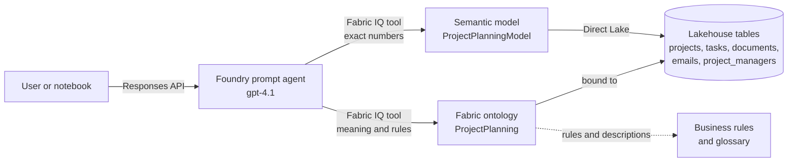
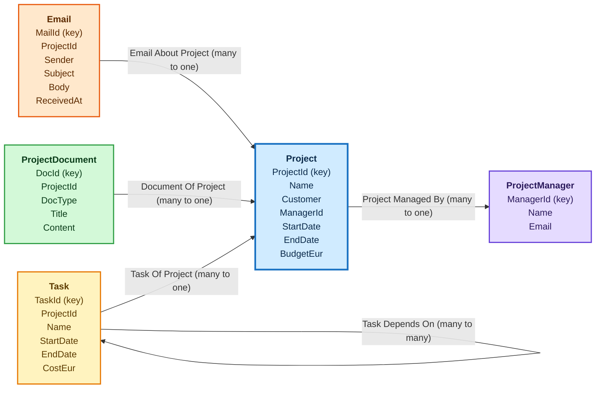
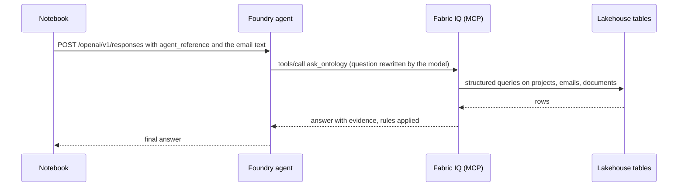

## The scenario

A construction company runs several projects. Customers send emails all day, and a project manager has to decide for each one: does this threaten the schedule, the budget or the contract? The answer depends on facts spread over three places:

* Contract documents (specification, offer, contract) saved as PDFs
* A small project database with the project manager and key data such as budget and dates
* The incoming emails

The agent in this repository takes an email and answers three questions. Which project does it belong to? Is it critical? Who has to do what next, and by when?

Take the email "Please add a green roof with photovoltaics. This should be covered by the fixed price." The agent finds the project, notices that a green roof is outside the specification, quotes the offer clause that charges changes by effort (EUR 85 per hour), rates the email as critical and names the project manager who must be told within one working day.

## Architecture at a glance



Two platforms are involved:

* Microsoft Foundry hosts the model and the agent. It only knows Fabric IQ tools: one for the ontology and one for the semantic model.
* Microsoft Fabric holds the data, the ontology and the semantic model. Fabric answers the questions the agent sends to the tools.

The agent has no search index, no function code and no copy of the data. The business knowledge sits in the ontology, the calculations in the semantic model.

## Fabric in five minutes

You do not need to learn Fabric to follow this demo. These terms are enough, each with a Foundry comparison.

| Fabric term | What it is | Foundry comparison |
|-------------|-----------|--------------------|
| Capacity | Reserved compute that every Fabric workload runs on. This demo uses the smallest paid size, F2, which you can pause. Cost accrues while it runs. | Similar to a provisioned throughput deployment: you pay for reserved capacity, not per request. |
| Workspace | A container for Fabric items, assigned to one capacity. Access is granted per workspace. | A Foundry project or resource group. |
| Item | Everything in a workspace is an item: lakehouse, notebook, report, ontology. Each item type has a REST API. | A resource inside a Foundry project, such as an agent or a connection. |
| OneLake | One storage layer for the whole tenant. Items store their data there. | Like the storage account behind a Foundry project, but shared and managed. |
| Lakehouse | An item that stores files and tables in OneLake. Tables are Delta tables. It also exposes a read-only SQL endpoint. | A database plus a file share in one item. |
| Ontology | An item that describes your business in terms of entities, relationships and rules and links them to tables. | Closest to a semantic layer or a typed knowledge base for agents. |

## What an ontology is

A table says that column `ManagerId` holds text. An ontology says that a project is led by a project manager, that an email refers to exactly one project, and that a critical email must reach the project manager within one working day.

An ontology contains five kinds of things:

| Concept | Meaning | Example in this demo |
|---------|---------|----------------------|
| Entity type | A kind of business object | `Project`, `Email` |
| Property | A fact about an entity | `Project.BudgetEur` |
| Relationship | A named link between two entity types | `Email About Project` |
| Rule | A business policy written in plain language and linked to entities | `EscalationPolicy` |
| Data binding | The link from an entity or property to a table or column | `Project` is backed by table `projects` |

Descriptions and synonyms are metadata on entities, properties and relationships. A synonym such as "Project lead" for `ProjectManager` helps the agent understand a question that uses different words.

### Ontology compared with retrieval

In a typical Foundry setup an agent retrieves text chunks from an index (Azure AI Search or file search) and the model reasons over those chunks. An ontology works differently:

* The agent asks a question in natural language. Fabric turns it into structured queries over the bound tables, so numbers and joins come from the data, not from reading text.
* The meaning of the data (descriptions, synonyms, rules) is stored once in the ontology and shared by every agent that uses it. It does not have to be repeated in each prompt.
* Access is checked per user by Fabric.

> [!NOTE]
> Retrieval remains the better choice for large volumes of unstructured text. This demo keeps the PDFs small enough to store as plain text in a table column. See [Limits of the demo](#limits-of-the-demo).

## The data model of the demo

Five tables become five entity types. A sixth table, `task_dependencies`, is a join table and has no entity type of its own: it only carries the relationship `Task Depends On`.



Blue marks the central entity type `Project`, orange the emails, green the documents, purple the people and yellow the tasks. Arrows point from the entity that holds the foreign key to the entity it refers to. `Task Depends On` points from a task to the tasks that have to finish before it.

| Entity type | Table | Source in `data/` |
|-------------|-------|-------------------|
| `ProjectManager` | `project_managers` | `project_managers.csv` |
| `Project` | `projects` | `projects.csv` |
| `ProjectDocument` | `documents` | PDFs in `data/pdfs/`, text extracted by `setup.py` |
| `Email` | `emails` | `emails.csv` |
| `Task` | `tasks` | `tasks.csv` |
| none (join table of `Task Depends On`) | `task_dependencies` | `task_dependencies.csv` |

The sample data has two projects, two project managers, four PDFs, five emails, 14 tasks (seven per project) and 15 dependencies between tasks. Amounts are in euros (columns `BudgetEur` and `CostEur`). The task costs of P-100 add up to exactly its budget of 2,400,000 EUR. The task costs of P-200 add up to 5,750,000 EUR, which is 15 percent above its budget of 5,000,000 EUR, so the cost warning email E-5 can be checked against the data. Every predecessor of a task ends before the task starts.

The dates and amounts use real data types (`dateTime` for dates, `double` for `BudgetEur` and `CostEur`), because sums, comparisons and date arithmetic need them. They match the column types of the lakehouse tables. All other columns are text.

### Tasks and the question about GQL

The task plan allows a question that goes over several steps: if the building permit is delayed, which tasks follow from it, directly or indirectly, what do they cost and how far does the final handover move? A first live test answered this correctly for P-100 (six dependent tasks, 2,380,000 EUR, 59 days, handover on 2028-02-12, more than the 8 weeks of the withdrawal clause) without the graph.

What the test showed:

* Fabric ran a single SQL statement that read all tasks of the project together with their predecessors (eight rows). The language model then followed the chain itself. Neither recursive SQL nor GQL was used.
* The SQL endpoint of the lakehouse cannot do recursive queries (error 8768 "Recursive CTEs are unsupported"). That would only matter if Fabric had to compute the chain in SQL.
* The graph of the ontology is not materialized. The graph item in the workspace is empty, and Fabric only fills it after you opt in under "Manage graph".

For seven tasks per project the language model manages without a graph. The case for GQL begins when a project has hundreds of tasks and long chains. Then the rows no longer fit into one query result, and a traversal in the graph (`->{1,10}` in GQL) is the safer way. Whether the endpoint that the agent uses would then choose GQL is not known: the tool description of `ask_ontology` names KQL, SQL, DAX and Python, but not GQL.

### The three business rules

The rules are plain sentences, stored in the ontology:

| Rule | Statement |
|------|-----------|
| `EmailCriticality` | An email is critical if it affects the completion date, the budget or the scope of its project, or if it contradicts an assumption or clause in the specification, offer or contract of that project. An email that only needs to be monitored is rated watch. All other emails are rated not critical. |
| `EscalationPolicy` | Every critical email must be escalated to the project manager of its project within 1 working day. |
| `ChangeRequestPolicy` | A customer request outside the specification is a change request. It must be charged separately and must not be absorbed into the fixed price. |

Each rule lists the entities and relationships it refers to, so consumers can find the rules that matter for a given entity. A rule can also carry a description with the background and annotations with extra metadata. `ChangeRequestPolicy` has both: the description explains why a change request is priced on its own, and the annotations say that it is a commercial rule that rests on the offer and the specification. The other two rules have neither yet.

## A semantic model for exact numbers

The ontology agent calculates inexactly. It counted 30 days for a task from 2027-01-01 to 2027-01-31 (31 days with both days counted), and an earlier answer called a delay of 59 days "exactly 8 weeks". Fabric does not promise otherwise: the documentation describes a natural language layer that turns questions into queries, and it lists a known issue with aggregation. Metrics are meant to come from the DAX measures of a Power BI semantic model, and the agent picks its query engine by the binding (SQL for lakehouse tables, DAX for semantic model measures).

The demo therefore has a small semantic model, `ProjectPlanningModel`, in `semantic_model/`. It reads the lakehouse tables `projects` and `tasks` through Direct Lake and has four DAX measures:

| Measure | Table | Meaning |
|---------|-------|---------|
| `Duration Days` | `tasks` | Days from the first start to the last end, both days counted. Filtered by `tasks[TaskId]` it is the duration of one task. |
| `Planned Cost EUR` | `tasks` | Sum of the task costs |
| `Budget EUR` | `projects` | Approved budget |
| `Budget Variance EUR` | `projects` | Planned cost minus budget, positive means over budget |

The agent has a second Fabric IQ tool for this model (the endpoint `fabricaihub/integrations/m365`, connection `fabric-iq-semantic-model`). This tool works differently from the ontology tool. Foundry's own model gets four tools (`DiscoverArtifacts`, `ValueSearch`, `GetReportMetadata`, `ExecuteQuery`) and writes the DAX query itself. The query is exact, but the way to it depends on the model:

* With a general prompt, one of six test questions was answered correctly. `ValueSearch` found no match for an id such as T-102, because the model has no search index, and the model gave up instead of querying.
* The agent prompt now names the model and its id, lists the measures, shows two example queries and says to skip `DiscoverArtifacts` and `ValueSearch`. With that prompt, 15 of 15 questions about the duration of two tasks and the budget variance of P-200 were right on a test agent with only this tool, and 15 of 15 on the real agent with both tools. Five runs per question is a small sample.
* The Foundry documentation recommends newer models such as gpt-5.4 for semantic model queries. The demo runs on gpt-4.1.

A combined question showed both tools working together: for the delay of task T-101 the ontology listed the six dependent tasks, and the semantic model gave their costs (2,380,000 EUR) and durations.

## The ontology as files

The ontology lives in [ontology/](../ontology) as text files in TMDL, the format Fabric uses for ontology definitions through its REST API and Git integration. A shortened entity looks like this:

```text
/// A construction project for a customer.
entity Project
    backingTable: projects
    keyProperty: ProjectId
    synonym 'Construction project'

    /// Project budget in euros (EUR).
    property BudgetEur
        dataType: string
        backingConfiguration
            valueColumn: projects.BudgetEur
```

The lines starting with `///` are descriptions. `backingTable` and `valueColumn` are the data bindings. A rule file is shorter:

```text
rule EscalationPolicy
    statement: Every critical email must be escalated to the project manager of its project within 1 working day.
    ruleReferencedEntity Email
    ruleReferencedEntity ProjectManager
```

| Path in `ontology/` | Content |
|---------------------|---------|
| `entities/*.tmdl` | One file per entity type with properties, descriptions, synonyms and bindings |
| `entityRelationships.tmdl` | The three named relationships |
| `relationships.tmdl` | The table level joins behind the relationships (foreign keys) |
| `rules/*.tmdl` | One file per business rule |
| `tables/*.tmdl` | The lakehouse tables the ontology reads, with their columns |
| `expressions.tmdl` | The connection to the lakehouse SQL endpoint, filled in at deployment |
| `model.tmdl`, `database.tmdl`, `namespaces/default.tmdl` | Index files that Fabric requires |
| `.platform` | Item type and display name |

## How the agent reaches the ontology

The link between both platforms is a Foundry project connection and one tool.

1. A project connection of category `RemoteTool` points to the MCP endpoint of the ontology: `https://api.fabric.microsoft.com/v1/mcp/dataPlane/workspaces/{workspaceId}/items/{ontologyId}/ontologyEndpoint`.
2. The connection uses `authType: UserEntraToken`. Foundry forwards the Microsoft Entra token of the calling user, with the Power BI API as audience, so Fabric sees the real user. The user needs access to the Fabric workspace.
3. The agent is a prompt agent with one tool of type `fabric_iq_preview` that references the connection. In the SDK that is `FabricIQPreviewTool(project_connection_id=...)`.

Under the hood the tool is an MCP server. In a response you see the same item types as for any MCP tool: `mcp_list_tools` and `mcp_call`. The server offers three tools:

| MCP tool | Purpose |
|----------|---------|
| `ask_ontology` | Answers a business question in natural language, based on the ontology and its bound data |
| `list_ontology_entities` | Returns the entity types with properties, descriptions, synonyms and bindings |
| `list_ontology_rules` | Returns the business rules |

In the test runs the agent called `ask_ontology` for the email questions, and the answers contained facts from the tables, clauses from the PDFs and the rules (for example "within 1 working day"). Neither the clause nor the deadline appears in the agent prompt.

### The agent prompt

The whole prompt is [agent_instructions.txt](../scripts/agent_instructions.txt):

```text
You are a project planning assistant for construction projects.

Answer every question with the Fabric IQ tool (the project ontology). Cite the documents or clauses you rely on.
When you call the tool, write a complete question and include the details of the user's message word for word, such as sender addresses, subjects, names and dates. Do not summarize or leave out details, because the tool needs them to find the project.
Do not invent data. If the ontology does not contain the information, say so.
```

It defines the role and the tool policy. The second sentence exists because the model writes the tool request itself. Without it, the model sometimes dropped the sender address, so Fabric could not find the project. The sentence asks for a complete question on purpose: a first version that said "pass the message unchanged" made the model send only the email text, and Fabric answered "I can help only with Azure-related topics". Entity lists, field descriptions and rating criteria are deliberately absent, because they would duplicate the ontology and drift out of date.

## What happens when an email arrives

The notebook [use_case.ipynb](../notebooks/use_case.ipynb) plays this flow with a Bash kernel.



1. The notebook builds a question from sender, subject and body and sends it to the agent through the Responses API, referencing the agent by name.
2. The model decides to call `ask_ontology` and rewrites the question for the tool.
3. Fabric answers the question from the tables and rules of the ontology. In this demo the sender address matches earlier emails of one project, so the project can be identified. The answer cites clauses of that project's documents and applies the rules.
4. The agent returns the verdict, the clause it relied on and the person responsible.

## Two language models, two jobs

Two language models take part in every answer.

| Model | Runs in | Job |
|-------|---------|-----|
| `gpt-4.1` deployment (ours) | Foundry | Reads the prompt, writes the question for the tool, then turns the tool result into the final text |
| Fabric's own model (not configurable, version unknown) | Fabric | Plans the answer, writes the T-SQL, reads the rows, applies the rules and writes a finished answer |

What supports this:

* The tool result already is a complete answer. The field `response` of the `mcp_call` item contains the project, the verdict, the quoted rule, the clause and the next steps with deadlines, formatted as the question asked.
* The Fabric call takes 40 to 65 seconds, of which the SQL is a fraction of a second per statement. The Foundry `chat` span takes 1 to 2 seconds.
* The Fabric documentation says that Azure OpenAI models plan the work and write the queries of the ontology agent, and that the agent sends schema metadata, a few sample rows and the query results to the model. The capacity usage page lists a meter "Ontology AI Reasoning" for "the ontology MCP server and ontology agent". The first statement describes the ontology agent, the second one includes the MCP server we call, so I assume both use the same machinery. The documentation does not name the model.

The final text in the notebook is the Foundry model's rewrite of the Fabric answer. Facts, rule quotes and deadlines come from Fabric.

### Is the Foundry model needed?

For this demo, technically not. A direct call of `ask_ontology` with a complete question returned the same kind of finished answer in 41 seconds, without Foundry. The Foundry model still earns its place when you need:

* The agent as one endpoint with its own prompt, content filters, tracing and access control
* A model that extracts the email details and decides when to call the tool, including in a conversation with several turns
* More tools next to the ontology, such as a mailbox, a search index or an action that creates a ticket
* A fixed answer format and citation policy that you control, independent of Fabric's wording

It also costs something. It adds one to two seconds and tokens, and it is a source of errors seen in this demo: the dropped sender address and a rejected tool request (see Limits). If the ontology is the only source and you only need the answer text, calling the Fabric endpoint directly is the leaner option.

## Deployment

`./deploy.sh` runs two stages, because Azure Resource Manager (and with it Bicep) can create the Azure resources but not the content inside Fabric.

| Stage | Tool | Creates |
|-------|------|---------|
| 1 | [infra/main.bicep](../infra/main.bicep) | Foundry account with project management, the `gpt-4.1` deployment, the Foundry project, the Fabric capacity F2, Log Analytics and Application Insights with the Foundry connection that turns on tracing, and the Foundry role assignments for the deployer. Key based auth is disabled, access uses Entra ID only. |
| 2 | [scripts/setup.py](../scripts/setup.py) | Fabric workspace, lakehouse, tables, ontology, the Foundry connection and the agent |

Stage 2 runs these steps in order:

1. Wait until the Fabric API lists the new capacity as active. This can take a few minutes after stage 1.
2. Create the workspace on the capacity and the lakehouse in it (skipped if they exist).
3. Upload the CSV files to OneLake. Extract the text of each PDF, one row per document, and upload that as the source of the `documents` table.
4. Load each CSV into a lakehouse table through the Load Table API.
5. Wait until the lakehouse SQL endpoint is ready.
6. Read the `ontology/` folder, replace the two placeholders `{{SQL_SERVER}}` and `{{SQL_DATABASE_ID}}` with the endpoint of the lakehouse, and create the ontology (or update its definition if it exists).
7. Create the Foundry connection to the ontology and the prompt agent, then ask a test question.

Every step is repeatable. Running `./deploy.sh` again updates the ontology in place and publishes a new agent version.

The script signs in through the Azure CLI. Another identity, for example a service principal from environment variables, does not see the capacity or the workspace, and the connection forwards a user token anyway.

## Where to change what

| Goal | Change |
|------|--------|
| Adjust a business rule | `ontology/rules/<Name>.tmdl` |
| Add a description or synonym | `///` lines and `synonym` lines in `ontology/entities/` |
| Add a table | A CSV in `data/`, `ontology/tables/<table>.tmdl`, a `ref table` line in `ontology/model.tmdl`, plus an entity file |
| Change the role or tool policy of the agent | `scripts/agent_instructions.txt` |
| Change the model or the capacity size | Parameters in `infra/main.bicep` |

Run `./deploy.sh` after any change.

## Observing a call

The last section of the notebook [use_case.ipynb](../notebooks/use_case.ipynb) follows one call through both platforms. The table shows where each source of evidence comes from.

| Question | Source | Where to look |
|----------|--------|---------------|
| Which agent configuration ran? | The Responses API echoes agent version, model, prompt and tool | Response JSON |
| What did the model ask Fabric? | `mcp_call` item and the span `execute_tool` | Response JSON, trace |
| How long did each stage take, how many tokens? | Server-side trace in Application Insights | Table `AppDependencies`, filter on `gen_ai.response.id` |
| Which configuration does Fabric hold? | MCP tools `list_ontology_rules` and `list_ontology_entities` | Direct call with your token |
| Which SQL did the ontology run, and as whom? | `queryinsights.exec_requests_history` of the lakehouse SQL endpoint | T-SQL, for example with `sqlcmd` |

A typical call has three spans. `invoke_agent` is the whole call, `execute_tool` is the Fabric call and `chat` is the model writing the final answer. In the measured runs, 95 percent or more of the time sat in the Fabric call, and the SQL statements themselves took well under a second each. The remaining time is spent inside Fabric before and between the statements.

Fabric has no separate log for ontology calls on this path that I could find. The SQL statements in Query Insights are the closest view. They show the user as `login_name`, which confirms that the Entra token passes through, and they show joins that follow the bindings and relationships of the ontology.

Traces reach Application Insights a few minutes after the call, so the notebook waits for them.

A live test confirmed that the ontology configuration drives the answer, and the notebook repeats it for the rule `ChangeRequestPolicy`. After changing the rule `EscalationPolicy` to "by phone within 2 hours" and uploading the ontology, the agent repeated that wording with the same prompt and data. In the notebook, replacing the statement of `ChangeRequestPolicy` by "quoted with a 15 percent surcharge and approved in writing" made the answer quote the surcharge and the written approval. The original rule is restored afterwards, in the notebook through an exit handler that runs `scripts/update_ontology.py`.

## Limits of the demo

* Fabric IQ and the ontology API are in preview. Names and behavior can change.
* PDF text is stored as one text column per document. There is no chunking, no embedding and no semantic search. This works for one page per document. For large document sets, a search index (for example Azure AI Search) fits better.
* Until the data types were corrected, the entities `Project` and `Email` declared their dates and the budget as text, although the lakehouse stores them with proper types. That worked in all tests, but the types are now aligned with the tables.
* Answers come from a language model, so wording and borderline ratings vary between runs. The same holiday email (a customer's office is closed over the holidays) was rated "not critical" in six of nine valid runs and "watch" in three. Both fit the rule.
* A description of the rule `EmailCriticality` with examples for "critical", "watch" and "not critical" did not remove that variance. In ten runs after adding it, the holiday email was rated "not critical" five times and "watch" five times. With these numbers, the difference to the runs before (three of nine "watch") is not significant, and I do not know whether the endpoint reads rule descriptions when it rates an email. The statement of the rule is the more likely lever, if a stable rating is needed.
* The model sometimes calls `list_ontology_rules` with an empty filter list. The server rejects that call and the request fails with HTTP 400. The prompt therefore does not ask the agent to list rules.
* The model writes the tool request itself and can still drop details such as the sender address. The prompt tells it to include them word for word, which worked in five of five test runs, but a language model gives no guarantee. Fabric also gives different ratings for the same email. In three runs the site plan email was rated "not critical" twice and "critical" once.
* Fabric limits the rate of requests to the ontology endpoint. Five agent calls at the same time returned HTTP 429 "RequestBlocked" for 8 of 15 calls, and the agent showed the error text as its answer. Even one call after the other was refused often during a longer series of about 30 calls, each time with a block of about a minute. I did not find out whether this is a service limit or a capacity limit of the small F2 SKU. Plan for a retry after a minute, and do not expect many users at the same time on this setup.
* Now and then the endpoint accepts a call but returns no valid answer ("did not return a valid MCP JSON-RPC response"). A repeated call works.
* Calculations by the model are not exact. An earlier answer called the delay from 2027-01-31 to 2027-03-31 "exactly 8 weeks", but it is 59 days.
* Metrics did not help. I added two explicit metrics through TMDL, `PlannedCostEur` (sum of the task costs) and `TaskDurationDays` (days from start to end, both days counted), once with the SQL dialect and once with the NaturalLanguage dialect. Fabric stored them, but `ask_ontology` ignored them in both variants, even when the question used the exact metric name. It answered 30 instead of 31 days for task T-101 and gave the project budget instead of the task sum. The documentation explains why: metrics are meant to come from the DAX measures of a Power BI semantic model, and the agent chooses its query engine by the binding (SQL for lakehouse tables, DAX for semantic model measures). The documentation does not say that the agent uses explicit metrics on lakehouse entities. The demo uses a semantic model with DAX measures instead, see "A semantic model for exact numbers".
* The tenant setting "Users can create Ontology (preview) items" must be on, and the Fabric capacity must be running. Pause the capacity when you are done to stop the cost.

## Glossary

| Term | Meaning |
|------|---------|
| Delta table | Open table format that lakehouse tables use |
| MCP | Model Context Protocol, the standard Foundry uses for remote tools |
| OneLake | The single storage layer of a Fabric tenant |
| SQL endpoint | Read-only T-SQL access to the tables of a lakehouse |
| TMDL | Text format for model definitions, used here for the ontology files |

## Further reading

* [Ontology overview](https://learn.microsoft.com/fabric/iq/ontology/overview)
* [Agent integration for ontology](https://learn.microsoft.com/fabric/iq/ontology/concepts-agent-integration)
* [Connect agents to Fabric with Fabric IQ](https://learn.microsoft.com/azure/foundry/agents/how-to/tools/fabric-iq)
* [Business rules in ontology](https://learn.microsoft.com/fabric/iq/ontology/how-to-use-rules)
* [Ontology definition format](https://learn.microsoft.com/rest/api/fabric/articles/item-management/definitions/ontology-definition)
